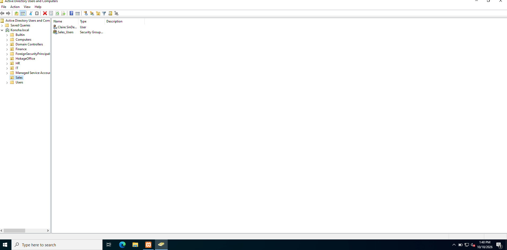
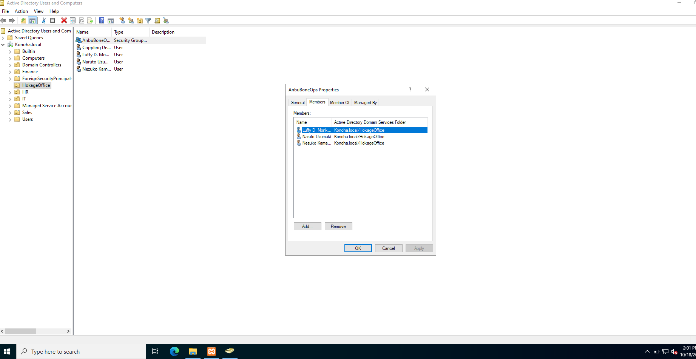
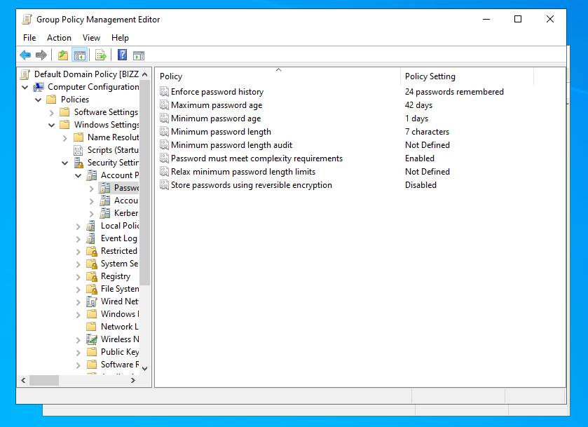

# Active Directory Domain Services (AD DS) & Infrastructure Lab

## 📌 Project Overview
This project documents the deployment, configuration, and operational management of an Active Directory Domain Services (AD DS) environment using **Windows Server 2022** on a virtualized enterprise domain (`Konoha.local`). The lab demonstrates core SysAdmin workflows including Organizational Unit (OU) design, Role-Based Access Control (RBAC), security group assignments, Group Policy Object (GPO) security enforcement, and user account management.

---

## 🛠️ Tech Stack & Environment
* **Operating System:** Windows Server 2022 Standard Evaluation
* **Directory Services:** Active Directory Domain Services (AD DS), DNS
* **Domain Name:** `Konoha.local`
* **Virtualization:** Oracle VirtualBox (`DC01`)

---

## 🚀 Key Implementation Steps

### 1. Domain Controller Deployment & OU Hierarchy
* Configured `DC01` as a primary Domain Controller running AD DS for the `Konoha.local` forest.
* Designed and built a structured Organizational Unit (OU) hierarchy to separate departmental accounts and resources (*Finance*, *HokageOffice*, *HR*, *IT*, *Sales*).

---

### 2. User Provisioning & Security Group Management
* Provisioned domain user accounts across designated departmental OUs (e.g., `HokageOffice`).
* Configured Role-Based Access Control (RBAC) by creating custom security groups (e.g., `AnbuBoneOps`) and populating group memberships to manage departmental permissions in bulk.

---

### 3. Group Policy Management (GPO) & Security Baseline
* Managed domain-wide security controls via the Group Policy Management Editor (`gpmc.msc`).
* Enforced password security policies across all domain users, including password complexity requirements, 7-character minimum length, and 24-password history enforcement.

---

## 💡 Key Skills Demonstrated
* **Active Directory Administration:** Domain Controller setup, OU hierarchy architecture, and user object management.
* **Access Control & Security:** Role-Based Access Control (RBAC), security group assignments, and least-privilege enforcement.
* **Group Policy Enforcement:** Custom GPO editing, domain-level security baselines, and password policy configuration.
* **System Administration:** Windows Server 2022 management tools (`dsa.msc`, `gpmc.msc`) and virtualized network infrastructure.
